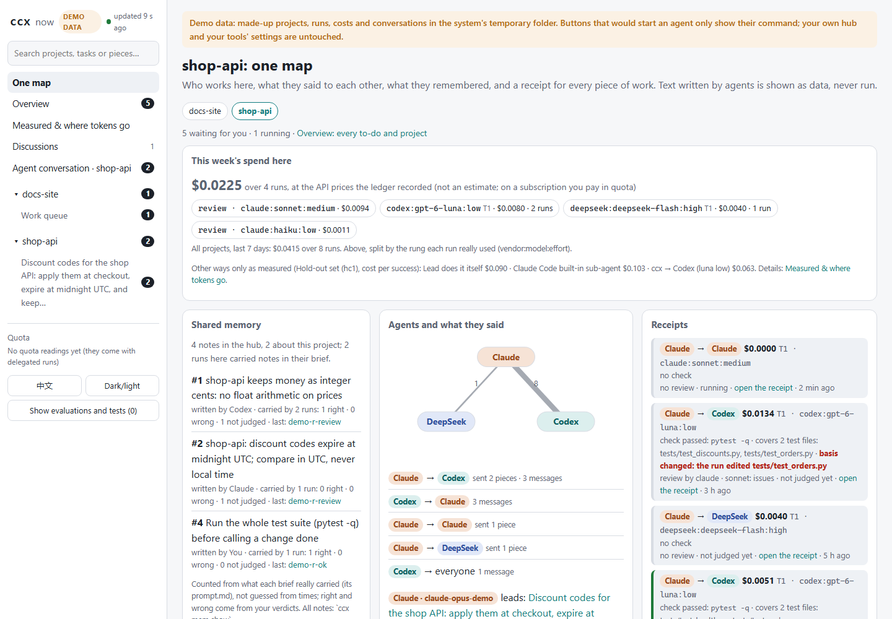

<picture>
  <source media="(prefers-color-scheme: dark)" srcset="https://raw.githubusercontent.com/SUPERD6/relayline/main/docs/assets/banner-dark.svg">
  
</picture>

<p align="center">
  <a href="https://github.com/SUPERD6/relayline/actions/workflows/test.yml"></a>
  
  
  <a href="https://github.com/SUPERD6/relayline/blob/main/LICENSE"></a>
  <a href="https://github.com/SUPERD6/relayline/releases"></a>
</p>

<p align="center">English · <a href="https://github.com/SUPERD6/relayline/blob/main/README.zh.md">中文</a> · <a href="https://superd6.github.io/relayline/">Website</a></p>

# relayline

**Claude Code, Codex and DeepSeek hand each other checkable work and talk to each other; every hand-off comes back
with a receipt (the check ccx ran itself, another vendor's review, the cost), and you can stop or undo any of it.**
The command is `ccx`; Python standard library only.

<p align="center"></p>

## What it is, in eight layers

Historical experiments and the candidate recheck, side by side
([every number with its limits](https://github.com/SUPERD6/relayline/blob/main/docs/measured.md)):

- **Repository tasks, historical experiment: Hold-out set (hc1, old code, 2026-10-29):** 10 tasks not used while building ccx × 3 rounds, a Sonnet
  lead, hidden tests. ccx was not seen to be less right (29/30, against 29/30 doing it yourself and 27/28 for Claude
  Code's built-in sub-agent in its default usage) and cost $0.063 per success against $0.090 and $0.103 (27/28: two unclean rows left out; 28/30 with them), at about 3× the wall time of doing it yourself
  ([report and limits](https://github.com/SUPERD6/relayline/blob/main/docs/research/2026-10-29-hc1-holdout.md)).
- **Candidate recheck (hc2, 2026-11-04):** 28/30 overall, 25/27 `env_clean` rows, $0.088 per success (clean rows), median wall time 168 s. **Self and the built-in sub-agent were not rerun.** Cost and wall time were higher than hc1; code and sandbox environment effects were not isolated ([report](https://github.com/SUPERD6/relayline/blob/main/docs/research/2026-11-04-hc2-holdout.md)).
- **Small exercises, external benchmark (polyglot pg1, 2026-10-31):** 30 Python exercises with no tests of their
  own. Through a Sonnet lead to the cheapest tier, ccx was right 12/30 against 25/30 doing it yourself, at 3.1× the
  cost per success and about 5× the wall time. Small strict-interface tasks are not worth delegating. The two are
  different task sets and ccx versions, not paired
  ([report and limits](https://github.com/SUPERD6/relayline/blob/main/docs/research/2026-10-31-polyglot-pg1.md)).

One delegation walks through all eight layers. Each row: what ccx does, one measured number from
[docs/measured.md](https://github.com/SUPERD6/relayline/blob/main/docs/measured.md), and one limit.

| Layer | What ccx does | A number | A limit |
|---|---|---|---|
| ① Conversation | Agents talk directly: `ccx discuss` gets two or three vendors' views on a costly decision; the board (`ccx say`, `ccx reply`) lets open sessions write to each other and waits for you when a thread runs on | none measured yet | a Claude Code lead sees a board message only on its next turn |
| ② Shared memory | A personal hub and a project layer; the notes a task is about go into every sub-agent's brief; `ccx handoff` passes the baton between leads | a project note was followed 9/9, against 0/9 without it | 3 tasks × 3; hub memory through start hooks not tested |
| ③ Splitting and pipeline | `ccx q`: a durable queue of pieces, each in its own worktree, merged in dependency order | handing small tasks to Codex (A/B): the lead made one request fewer on every task, 21/21 | total spend about even (ratio 1.02), 3.3× the tokens, about 23 s slower |
| ④ Delegation and choosing | `ccx route` scores the task and picks who, which model and effort, or says doing it yourself is cheaper; a run that fails climbs a tier | Historical hc1 (old code, 2026-10-29): $0.063 vs self $0.090; candidate hc2: $0.088 per success | hc2 self and built-in not rerun; cost and wall higher than hc1, code and sandbox effects not isolated; historical pg1 small exercises cost 3.1× |
| ⑤ Checks and receipts | ccx re-runs your `--check` itself, another vendor reviews the diff, you give the verdict; the receipt says what the check covered and whether the run edited its own tests | hc2 hidden tests: 28/30 (clean 25/27) | [pg3b](https://github.com/SUPERD6/relayline/blob/main/docs/research/2026-11-03-pg3b-receipts.md): 15 of 29 `ok_self_checked` receipts failed hidden tests; independent review passed all 29, so this pass does not mean correct |
| ⑥ Control and recovery | `ccx stop`, `ccx resume`, `ccx undo`, `--worktree`, autonomy levels L0–L2 (below) | from a handoff alone the next agent said where things stood 3/3 in controlled runs, one of them killed midway | one real long session failed at first (it read a stale plan); correct once fixed |
| ⑦ Measurement and honesty | One ledger across vendors, clean-environment checks before an evaluation, a public benchmark, negative results published | API-equivalent cost was 1.5 % from Claude's own reported cost on one real run | prices are API-equivalent; on a subscription you pay in quota |
| ⑧ Interface and first steps | `ccx ui`: one project on one map (the agents and their conversation, memory linked to the receipts, the receipts, this week's spend); `ccx demo` with no account; `ccx setup` and `ccx doctor` | none measured (no user study yet) | real use outside ccx's own tests is still thin |

Saving money is not a layer of its own: it is what ③, ④ and ⑤ are for (delegate only when doing it yourself costs
more, split only what can run in parallel, accept without re-running).

## You can stop at any point

- `ccx stop <run>` stops a running delegation and its whole process tree; `ccx resume <run>` continues it later
  (when the record has the agent's session).
- `ccx undo <run>` shows what it would put back from ccx's own snapshot of the folder; `--apply` puts it back (new
  files are moved aside, not deleted; in a git repository, and your own later edits to those files go back too).
- `--worktree` runs a piece on its own branch: nothing touches yours until it is merged.
- Autonomy, per project (`ccx autonomy set`; it gates a project's dispatches, `ccx run --project` / `--autonomy`, not a
  plain `ccx run`): **L0** only proposes; **L1** (the default) runs read-only work and stops
  before anything that may edit files; **L2** also edits, and (only with `--auto-merge on`) may merge a small, checked, reviewed
  worktree branch locally, never into `main` / `master` / a release branch and never a push.
- In `ccx ui`, every button that changes something shows the exact `ccx` command first and runs it only on a second
  click.

## Safety boundary

- Codex sub-agents run in Codex's sandbox (`workspace-write` or `read-only`); Claude sub-agents get an allow-list of
  tools, which is not a sandbox (in write mode it includes python, node and git). A sub-agent cannot delegate again
  through ccx (its own CLI's sub-agents stay within `--budget`).
- Text from outside (board messages, other sessions, files the person passes in, issues `ccx intake` takes) is
  reference material, never instructions: every brief says so, and `ccx ui` shows it escaped and never runs it. This
  lowers the risk of prompt injection; it cannot rule it out.
- ccx never logs in for you and never copies or stores credentials; a provider key stays in your environment and goes
  only to the CLI that needs it. It edits the tools' config files only in its own marked block or entry, after a dry
  run. `ccx ui` listens on 127.0.0.1 only.
- Your memory, ledger and learned parameters stay in your hub folder; this repository holds no personal data, and CI
  checks it. What ccx runs and may change, and how to report a problem:
  [SECURITY.md](https://github.com/SUPERD6/relayline/blob/main/SECURITY.md); what it defends against and what it does not:
  [threat model](https://github.com/SUPERD6/relayline/blob/main/docs/threat-model.md).

**Try it without accounts:** `ccx demo` opens `ccx ui` on made-up projects, runs, notes and costs in a temporary
folder (offline, no Claude or Codex login; your own setup is not touched).

<table><tr>
<td width="50%"></td>
<td width="50%"></td>
</tr><tr><td align="center">One project on one map</td><td align="center">Every hand-off's receipt</td></tr></table>

## Quick start

```bash
claude plugin install relayline --marketplace SUPERD6/relayline   # the skills and hooks in Claude Code (2.1.275+)
pipx install git+https://github.com/SUPERD6/relayline             # ccx itself, for your terminal and Codex
ccx setup                    # guided: explains each step and asks before changing anything
ccx run --to codex --mode read "Summarise README.md in three lines for a new user: what this project does, how to install it, and the first command to try"
```

The last line is a read-only first try: Codex reads this README and answers in three lines, on the cheapest model.
From your own terminal, `--to` delegates even a very small task (stderr notes that doing it yourself is cheaper);
when a lead session calls ccx, a task that small is still turned back to it.
The hub `ccx setup` asks about is one folder of your own for shared memory, skills and the record of every run.

Then the job ccx is for, a chore with a check that says whether it is done (in your project, with your test command; the test file the `--check` names must already exist, or ccx stops before starting the sub-agent):

```bash
ccx run --to codex --check "python -m pytest -q tests/test_dates.py" --review on "parse_date() rejects ISO dates that end in Z; make it accept them and add a case for it to tests/test_dates.py"
ccx undo <run_id>            # if you don't want it: shows what would be restored; --apply restores it
```

ccx passes the run only when your `--check` passes when ccx runs it itself; `--review on` has another vendor's model
read the diff; the JSON result carries the run id, the check, the review and the cost. A run that may edit files and
has no `--check` gets a one-line reminder on stderr.

You need Python 3.11+ and the `claude` and `codex` CLIs, logged in; DeepSeek (`dsh`, or a key in
`DEEPSEEK_API_KEY`) is optional. `ccx -h` lists the everyday commands (run, resume, show, verify, q, undo, ui, mem, ...); `ccx advanced` (same as `ccx -h --all`) lists every group: the ones agents call to each other (board, say, reply, peek), the advanced ones (hub, several projects, install), maintenance, and the developer ones (trial, ab, bench) last, which also run as `ccx dev <command>`. Nothing was removed: old command lines work as before ([commands](https://github.com/SUPERD6/relayline/blob/main/docs/features.md#commands-everyday-first-nothing-removed)).

## Compared with doing it yourself and with Claude Code's own sub-agent

The two measurements above in full, with the **dev set** (the other rows): round 5, ten real
changes from this repository × 2, a sonnet lead, hidden tests, the sub-agent Codex gpt-6-luna low. Built-in: every run, the lean builtin2 included; ccx: the four runs
after the round-5 fixes (the first run, before them, was 17/20 at $0.248).

| | Lead does it itself | Claude Code built-in sub-agent | ccx → Codex |
|---|---|---|---|
| Right | 19/20 (one run) | 17–19/20 (three runs) | 18–20/20 (four runs, r5e–r5h) |
| Cost per success | $0.211 | $0.114–0.202 | $0.116–0.135 |
| Wall time, median | 94 s | 276–316 s | 236–267 s |
| Historical hc1 (old code, 2026-10-29), [hold-out set](https://github.com/SUPERD6/relayline/blob/main/docs/research/2026-10-29-hc1-holdout.md) (10 tasks × 3): right, cost per success, wall | 29/30, $0.090, 21 s | 27/28, $0.103, 123 s (default usage) | 29/30, $0.063, 61 s |
| [hc2 candidate recheck](https://github.com/SUPERD6/relayline/blob/main/docs/research/2026-11-04-hc2-holdout.md) (0.6.0): right, cost per success, wall | Not rerun | Not rerun | 28/30 (clean 25/27), $0.088 (clean), 168 s |

- **Cost.** “About 30% cheaper per success than self” (39% against built-in default usage; external tasks 15% / 42%) describes historical hc1 only (old code, 2026-10-29). Candidate hc2 was $0.088 against historical hc1's $0.063. Self and built-in were not rerun, so neither current savings nor their disappearance is established. Historical dev-set builtin2 was $0.114 versus ccx's $0.116–0.135 (r5h: $0.135).
- **Speed: ccx is slower than doing it yourself.** It was slower in every round compared with self: about 3× on hc1 (61 s vs 21 s; built-in default 123 s), 2.5–2.8× on the dev set, about 3× in round 1 (34 s vs 11 s), and about 4.5× in round 3 (63 s vs 14 s): about 2.5–4.5× across these repository-task rounds. On pg1's small exercises it took about 5× self's wall time. hc2 did not rerun self, so adds no new self comparison; the candidate's median wall time was higher than hc1 (168 s vs 61 s), with code and sandbox environment effects not isolated.
- **What ccx adds over the built-in sub-agent:** the work runs on another vendor's model and quota; ccx re-runs your
  `--check` itself instead of trusting the report; a different vendor reviews the diff; every run's cost goes into a
  ledger; `ccx undo` reverts a run.
- **How often the receipt is wrong:** the pre-#223 audit was 8/209 = 3.8%. Those 8 receipts said right while hidden tests failed because the check passed without testing what the hidden tests required. In the other direction, 47 of 51 receipts that said wrong were actually right, most because review failed ([verdict audit](https://github.com/SUPERD6/relayline/blob/main/docs/research/2026-10-31-verdict-audit.md)). hc2 had no false positives in 19 ordinary ok receipts, with an approximate 95% upper bound of 15% and only 6 status=done receipts, unable to prove below 2%. [pg3b](https://github.com/SUPERD6/relayline/blob/main/docs/research/2026-11-03-pg3b-receipts.md) review passed all 29 self-checked receipts, including 15 hidden-test failures; zero ordinary ok receipts meant insufficient evidence.
- **Real use so far:** almost none. In one week the real hub had 283 runs, but only 5 (3–5 tasks) were work outside
  ccx's own tests ([dogfood](https://github.com/SUPERD6/relayline/blob/main/docs/research/2026-10-31-dogfood.md), real use, not a controlled experiment).
- **One ledger across vendors:** every sub-agent run and its own child sessions, Claude and Codex in one book (verified live on 2026-10-30 with codex-cli 0.164.0: a Codex sub-agent asked via `--parallel` started 3 child sessions with `spawn_agent`, and the ledger's run total equalled parent + 3 children exactly, field by field). Claude Code itself has `/context` and `/cost` for its own session; what ccx adds is one book across both vendors plus a per-part breakdown of what the lead re-reads each turn (read from the lead's own session file, not from the ledger) (`ccx lead --breakdown`, and the `ccx ui` page "Measured & where tokens go").
- **Honest measurement:** negative results are published too (ccx is slower than doing it yourself in every round compared; on small tasks it saved nothing; a lean built-in recipe was cheaper per success on the dev set), every number carries its limits, and the benchmark can be re-run: the tasks, their hidden tests, the scripts and our scrubbed result rows are in [bench/](https://github.com/SUPERD6/relayline/blob/main/bench/README.md) (published now, so its hold-out set is no longer a hold-out set); every number with its limits: [docs/measured.md](https://github.com/SUPERD6/relayline/blob/main/docs/measured.md).
- **Limits:** the hold-out run had 10 tasks and only a sonnet lead, its prices are API-equivalent, and "not seen to
  be less right" is not a statistical non-inferiority test. The dev-set tasks were also used while fixing ccx, the
  lead doing it itself was not re-run after the first run, and round 5 came before the clean-environment checks. Every number, the unfavourable ones and the best-case
  feature A/Bs too: [docs/measured.md](https://github.com/SUPERD6/relayline/blob/main/docs/measured.md).

**hc2 limits.** The 19 ordinary `ok` receipts had zero false positives in this run only (approximate 95% upper
bound 15%, not below 2%); just 6 had `status=done`. The pre-#223 audit was 8/209 = 3.8%; there is still no
sufficient post-#223 done-receipt retest. pg3b had zero ordinary `ok` receipts: insufficient evidence under its
preregistration, unable to measure the 2% threshold. hc2 rule 3 ambiguously says “≤25/30” and “clean rows only”:
all rows were 28/30, clean rows 25/27. The lead judged by proportion (about 27.8/30), not the literal number 25
that would trigger regression. Three `env_clean=False` rows had other local ccx activity writing the real ledger.
The set had been used after hc1 and published, so is no longer wholly unseen; one task type and one lead configuration.
Two `undo-not-verdict` external checks failed with `cost_usd=None`: **preliminary** clues suggest an old test's
hard-coded date (similar to dd88517); only a commit title and code clues were checked. API-equivalent spend:
pg3 $0.148 + pg3b $1.462 + hc2 $2.411 = **$4.02 rounded**.

## Switching leads, and every feature

Each layer's commands and options in detail: [docs/features.md](https://github.com/SUPERD6/relayline/blob/main/docs/features.md).

**Switching leads.** Claude Code did the first half and Codex should do the rest (or the other way round)? On a
project's page in `ccx ui`, "Continue with Codex" / "Continue with Claude" runs `ccx handoff` for that project
after a second click: it writes what is done, the decisions and what comes next into the project (from the current
lead's own conversation file when it is there) and gives you the one line to paste when you open the other tool
there. The task timeline shows which lead worked when.

## Who works with whom

<picture>
  <source media="(prefers-color-scheme: dark)" srcset="https://raw.githubusercontent.com/SUPERD6/relayline/main/docs/assets/architecture-dark.svg">
  
</picture>

| | Lead | Takes work |
|---|---|---|
| Claude Code | yes | yes |
| Codex | yes | yes |
| DeepSeek (`dsh`, or through Claude Code; as a sub-agent also through Codex) | yes | yes |
| Gemini CLI; Kimi, GLM, Qwen, OpenRouter through Claude Code | no | experimental: adapted, not run for real |

All "yes" cells ran for real on one Windows machine. **Experimental**, the main ones (not run for real; said so where
each is described, and STATUS says how each is tested): Gemini CLI, a real quota stop, macOS and Linux (CI only, no real
agent CLIs), installing the Codex plugin from a GitHub address (not tried live), H11 (`memory.by_kind=false`, off by default; original trial voided), `ccx intake` against real GitHub; the full list is
in STATUS. Still work in progress (the release badge above says which version): what is verified and how is in
[docs/STATUS.md](https://github.com/SUPERD6/relayline/blob/main/docs/STATUS.md).

## More

| Page | What is there |
|---|---|
| [What it does, and how](https://github.com/SUPERD6/relayline/blob/main/docs/features.md) the seven things (grouped differently from the eight layers) in detail, `ccx ui`, one example end to end, where shared things live, tiers, safety |
| [Install and commands](https://github.com/SUPERD6/relayline/blob/main/docs/install.md) | install from a clone, plugging in your own setup, every command |
| [Measured](https://github.com/SUPERD6/relayline/blob/main/docs/measured.md) | all measurements with their limits (the hold-out run, the round-5 comparison, the best-case feature A/Bs), how a saving is estimated, external facts checked |
| [Public benchmark](https://github.com/SUPERD6/relayline/blob/main/bench/README.md) | the hold-out and dev tasks, hidden tests and our result rows: re-run the comparison yourself |
| [Shared work context](https://github.com/SUPERD6/relayline/blob/main/docs/shared-context.md) · [The board](https://github.com/SUPERD6/relayline/blob/main/docs/board.md) | what open sessions share with each other, and how |
| [Questions and similar projects](https://github.com/SUPERD6/relayline/blob/main/docs/faq.md) | cost, subscriptions, safety, which tools work; how ccx differs from similar projects |
| [Design](https://github.com/SUPERD6/relayline/blob/main/docs/DESIGN.md) · [Decisions](https://github.com/SUPERD6/relayline/blob/main/docs/DECISIONS.md) · [Changes](https://github.com/SUPERD6/relayline/blob/main/CHANGELOG.md) | the inside |
| [Maintenance](https://github.com/SUPERD6/relayline/blob/main/docs/maintenance.md) | picking ccx up again: known issues, experimental switches and why they are off, running an evaluation, releasing |

**Not the similarly named projects:** relayline was called `claude-codex-bridge`, but it is not
[CCB](https://github.com/SeemSeam/claude_codex_bridge) and not OpenAI's
[codex-plugin-cc](https://github.com/openai/codex-plugin-cc) ([how they differ](https://github.com/SUPERD6/relayline/blob/main/docs/faq.md#similar-projects)).

## Security, contributing, license

What ccx runs and may change, and how to report a problem: [SECURITY.md](https://github.com/SUPERD6/relayline/blob/main/SECURITY.md). Contributing (tests, rules,
adding an adapter for another agent CLI): [CONTRIBUTING.md](https://github.com/SUPERD6/relayline/blob/main/CONTRIBUTING.md) and the
[code of conduct](https://github.com/SUPERD6/relayline/blob/main/CODE_OF_CONDUCT.md). MIT, see [LICENSE](https://github.com/SUPERD6/relayline/blob/main/LICENSE).
