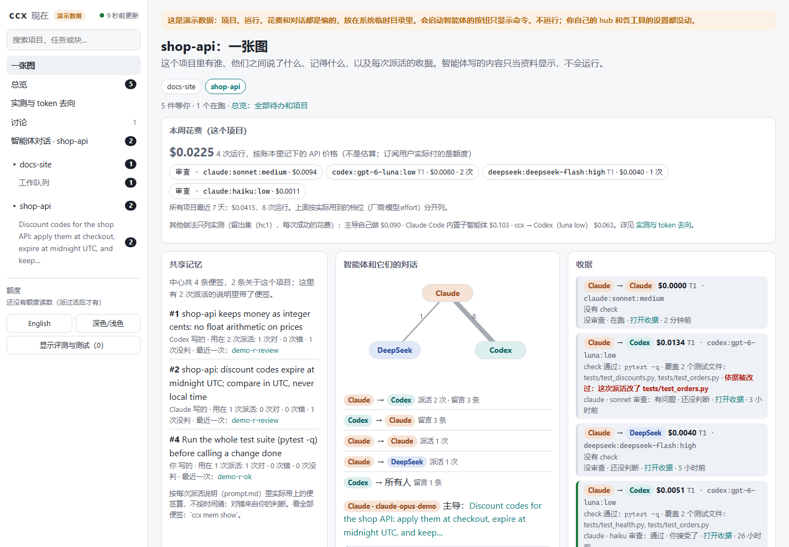

<picture>
  <source media="(prefers-color-scheme: dark)" srcset="docs/assets/banner-dark.svg">
  
</picture>

<p align="center">
  <a href="https://github.com/SUPERD6/relayline/actions/workflows/test.yml"></a>
  
  
  <a href="LICENSE"></a>
  <a href="https://github.com/SUPERD6/relayline/releases"></a>
</p>

<p align="center"><a href="README.md">English</a> · 中文 · <a href="https://superd6.github.io/relayline/zh/">网站</a></p>

# relayline

**Claude Code、Codex、DeepSeek 互相派能验收的活、互相说话；每次派活都带回一张收据（ccx 自己重跑的验收、另一家的审查、
花费），任何一步你都能停下或撤回。** 命令是 `ccx`，只用 Python 标准库。

<p align="center"></p>

## 八层讲清它是什么

先并列两个实测，因为它们指向相反的方向（[每个数字和它的局限](docs/measured.zh.md)）：

- **仓库任务，留出集（hc1，2026-10-29）：** 做 ccx 时没用过的 10 个任务 × 3 轮，Sonnet 当主导，隐藏测试。ccx 未见正确率
  更差（29/30，自己做 29/30，Claude Code 内置子智能体的默认用法 27/28：两行不干净剔除，算上是 28/30），每次成功花 $0.063，自己做 $0.090、内置 $0.103；
  用时约为自己做的 3 倍（[报告和局限](docs/research/2026-10-29-hc1-holdout.zh.md)）。
- **小题，外部基准（polyglot pg1，2026-10-31）：** 30 道 Python 练习题，题目本身没有测试。经 Sonnet 主导派给最便宜档，
  ccx 做对 12/30，自己做 25/30，每次成功的花费是自己做的 3.1 倍，用时约 5 倍。小而接口严格的题别派；
  两次是不同的题和不同的 ccx 版本，不是配对比较
  （[报告和局限](docs/research/2026-10-31-polyglot-pg1.zh.md)）。

一次派活会走过全部八层。每行：ccx 做什么、一个出自 [docs/measured.zh.md](docs/measured.zh.md) 的实测数字、一个限制。

| 层 | ccx 做什么 | 一个数字 | 一个限制 |
|---|---|---|---|
| ① 对话 | 智能体直接对话：`ccx discuss` 让两三家对一个代价高的决定各给意见；对话板（`ccx say`、`ccx reply`）让开着的会话互相留言，话题聊太久会停下等你 | 还没有实测 | Claude Code 当主导时，要到下一轮才看到对话板消息 |
| ② 共享记忆 | 个人中心（hub）和项目层；跟任务有关的便签自动写进每个子智能体的说明；`ccx handoff` 在主导之间交接 | 项目便签被遵守 9/9，没有便签 0/9 | 3 个任务 × 3；经启动钩子注入的 hub 记忆没测 |
| ③ 拆分与流水线 | `ccx q`：持久的工作队列，每块一个 worktree，按依赖顺序合并 | 小任务交给 Codex 的对照：主导每个任务都少发一次请求，21/21 | 总花费基本持平（比值 1.02），token 3.3 倍，慢约 23 秒 |
| ④ 派活与选人 | `ccx route` 给任务打分，选派给谁、什么模型和 effort，或者直说自己做更便宜；做失败了升一档 | 仓库任务每次成功 $0.063，自己做 $0.090（hc1，便宜约 30%） | 只看干净的一半（外部仓库）约便宜 15%；小题每次成功贵 3.1 倍，其中 82% 花在主导那边（pg1） |
| ⑤ 验收与收据 | ccx 自己重跑你的 `--check`，另一家审查改动，你给结论；收据写明 check 覆盖了哪些测试、这次派活有没有改它自己的测试 | 派出去的活隐藏测试下做对 29/30（hc1） | pg1 的题没有测试：check 跑的是子智能体自写的测试，ccx 做错的 18 题它全都判过；现在这种通过记为 `ok_self_checked` 并送审（还没重测） |
| ⑥ 控制与恢复 | `ccx stop`、`ccx resume`、`ccx undo`、`--worktree`、自主度 L0–L2（见下） | 只靠交接文件，下一个智能体说清进度 3/3（受控运行，其中一次中途被杀） | 一个真实长会话起初失败（读到了过期的计划），修后才对 |
| ⑦ 测量与诚实 | 跨厂商一本账、评测前查干净环境、公开基准、负结果也发布 | 一次真实运行上，API 等价花费和 Claude 自报花费差 1.5% | 价格是 API 等价价；订阅用户实际付的是额度 |
| ⑧ 界面与上手 | `ccx ui`：一个项目一张图（智能体和它们的对话、记忆连到收据、收据、本周花费）；`ccx demo` 不用账号；`ccx setup` 和 `ccx doctor` | 还没有实测（没做过用户研究） | 在 ccx 自己的测试之外，真实使用还很少 |

省钱不是单独一层，是 ③④⑤ 的目标：自己做更贵才派、能并行才拆、验收少重跑。

## 你随时能停

- `ccx stop <运行>` 停下一次派活和它的整个进程树；`ccx resume <运行>` 以后接着做（记录里有智能体的会话时）。
- `ccx undo <运行>` 先列出会按 ccx 自己的快照还原哪些文件；加 `--apply` 才还原（新文件移到一边，不删；只在 git 仓库里，你之后对这些文件的修改也会一起撤掉）。
- `--worktree` 让一块活在自己的分支上做：合并之前，你的分支一点不动。
- 自主度，按项目设（`ccx autonomy set`；管的是项目派活，即 `ccx run --project` / `--autonomy`，普通 `ccx run` 不经过它）：**L0** 只给建议；**L1**（默认）只读的活自己派，可能改文件的先停下；**L2** 也改文件，
  打开 `--auto-merge on` 时还可以在本机合并一个小的、check 通过、审查通过的 worktree 分支，但永远不合进 `main` / `master` / 发布分支，也不推送。
- `ccx ui` 上每个会改东西的按钮，先显示完整的 `ccx` 命令，再点一次才运行。

## 安全边界

- Codex 子智能体跑在 Codex 的沙箱里（`workspace-write` 或 `read-only`）；Claude 子智能体用的是工具白名单，不是沙箱
  （写模式下包括 python、node 和 git）。子智能体不能再经 ccx 往下派活（它自己 CLI 的子智能体受 `--budget` 限制）。
- 外来的文字（对话板消息、别的会话、你给的文件、`ccx intake` 收的 issue）只是资料、不是指令：每份派活说明都这样写，
  `ccx ui` 转义显示、从不运行。这能降低提示注入的风险，不能完全排除。
- ccx 不替你登录，不复制、不保存凭据；服务商的 key 留在你的环境变量里，只交给需要它的那个 CLI。只在先给你看过的前提下
  改各工具配置文件里它自己标记的那一段或那一条。`ccx ui` 只监听 127.0.0.1。
- 你的记忆、账本和学到的参数都在你自己的 hub 文件夹里；这个仓库没有个人数据，CI 会检查。ccx 运行什么、可能改什么、怎么报告问题：
  [SECURITY.zh.md](SECURITY.zh.md)。

**不用账号先试：** `ccx demo` 在临时文件夹里用编出来的项目、运行、便签和花费打开 `ccx ui`（离线可用，不用登录 Claude 或 Codex，
不碰你自己的设置）。

<table><tr>
<td width="50%"></td>
<td width="50%"></td>
</tr><tr><td align="center">一个项目一张图</td><td align="center">每次派活的收据</td></tr></table>

## 快速开始

```bash
claude plugin install relayline --marketplace SUPERD6/relayline   # Claude Code 里的技能和 hook（2.1.275+）
pipx install git+https://github.com/SUPERD6/relayline             # ccx 本体，给终端和 Codex 用
ccx setup                    # 向导：每一步都说明，改东西前先问
ccx run --to codex --mode read "Summarise README.md in three lines for a new user: what this project does, how to install it, and the first command to try"
```

最后一行是只读的第一次试用：Codex 读这份 README，用最便宜的模型三行作答（命令和英文版一致。你在自己的终端里用 `--to`
点名时，再小的任务也会派出去，只在 stderr 提示一句自己做更省；主会话代为调用时，太小的任务仍会被建议自己做）。`ccx setup` 问到的 hub 是你自己的一个文件夹，放共享记忆、技能和每次运行的记录。

然后是 ccx 真正要做的事：一件有验收命令、能判断做没做完的杂活（在你的项目里，用你自己的测试命令；`--check` 里点名的测试文件必须已经存在，否则 ccx 在启动子智能体之前就会停下）：

```bash
ccx run --to codex --check "python -m pytest -q tests/test_dates.py" --review on "parse_date() rejects ISO dates that end in Z; make it accept them and add a case for it to tests/test_dates.py"
ccx undo <run_id>            # 不想要：先显示会还原什么；加 --apply 才真还原
```

只有 ccx 自己跑你的 `--check` 通过了，这次运行才算过；`--review on` 让另一家的模型读改动；JSON 结果里有运行 id、
验收、审查和花费。可能改文件、却没给 `--check` 的运行，会在 stderr 提醒一行。

需要 Python 3.11+，以及登录好的 `claude` 和 `codex` 命令行；DeepSeek（`dsh`，或 `DEEPSEEK_API_KEY` 里的密钥）可选。
`ccx -h` 只列日常命令（run、resume、show、verify、q、undo、ui、mem 等）；`ccx advanced`（等于 `ccx -h --all`）列出所有分组：智能体之间互相调用的（board、say、reply、peek）、进阶（hub、多个项目、安装）、维护，开发者用的（trial、ab、bench 等）放在最后，也可以写成 `ccx dev <命令>`。一个命令都没删，旧写法照常能用（[命令](docs/features.zh.md#命令日常的在前一个不删)）。

## 和自己做、和 Claude Code 自带的子智能体比

上面两个实测的完整数字，以及**开发集**（其余几行）：第 5 轮，本仓库 10 个真实改动 × 2，
sonnet 当主导，隐藏测试，子智能体是 Codex gpt-6-luna low。内置子智能体：每一轮都算，包括精简做法的 builtin2；ccx：第 5 轮修完之后的四轮（修之前的第一轮是
17/20、每次成功 $0.248）。

| | 主导自己做 | Claude Code 内置子智能体 | ccx → Codex |
|---|---|---|---|
| 做对 | 19/20（一轮） | 17–19/20（三轮） | 18–20/20（四轮，r5e–r5h） |
| 每次成功的花费 | $0.211 | $0.114–0.202 | $0.116–0.135 |
| 用时中位数 | 94 秒 | 276–316 秒 | 236–267 秒 |
| [留出集](docs/research/2026-10-29-hc1-holdout.zh.md)（10 个任务 × 3）：做对、每次成功、用时 | 29/30、$0.090、21 秒 | 27/28、$0.103、123 秒（默认用法） | 29/30、$0.063、61 秒 |

- **花费。** 留出集上 ccx 每次成功比自己做低约 30%，比内置子智能体的**默认用法**低约 39%；只看其中 5 个别的仓库的任务
  （干净的一半：本仓库自己的任务，答案可能就在 ccx 的代码里）低约 15% / 42%。精简做法的内置子智能体（builtin2，给内置
  子智能体用 ccx 的精简做法）不在那次运行里：开发集上它每次成功 **$0.114**，比我们最近一轮 ccx（r5h，**$0.135**；ccx 的
  范围是 $0.116–0.135）便宜，所以两种派活方式还分不出胜负。在开发集那些较大的任务上，两者每次成功都比主导自己做便宜。
- **速度：ccx 比自己做慢**，留出集上约 3 倍（61 秒对 21 秒；内置子智能体默认用法 123 秒），开发集上是主导自己做的 2.5–2.8 倍；第 1 轮的小任务约 3 倍（34 秒对 11 秒），第 3 轮更难、
  更含糊的小包任务（主导是新开的短对话）约 4.5 倍（63 秒对 14 秒）：合起来 2.5–4.5 倍。小一些的任务上，总花费和自己做相比第 1、4 轮基本持平，第 3 轮更贵（每次成功 $0.071 对 $0.045）。
- **ccx 比内置子智能体多给的：** 活跑在另一家的模型和额度上；ccx 自己重跑你的 `--check`，不只信报告；另一家审查改动；
  每次运行的花费进账本；`ccx undo` 撤回一次运行。
- **收据多常错：** 收据误报 8/209（3.8%，#158 后，截至 3a15b8b 的评测）；超过 2% 的门槛，已列为发布前必修，正在修。这 8 次
  收据说对，隐藏测试却没过，原因是 check 过了，但没测到隐藏测试要的那条。反过来，收据说错的 51 次里有 47 次其实是对的，多数是审查没过（[收据误报审计](docs/research/2026-10-31-verdict-audit.zh.md)）。
- **目前的真实使用：** 几乎没有。一周里真实 hub 记了 283 次运行，只有 5 次（3 到 5 个任务）是 ccx 自测之外的活
  （[dogfood](docs/research/2026-10-31-dogfood.zh.md)，真实使用，不是对照实验）。
- **跨厂商一本账：** 每次子智能体运行以及它自己开的子会话，Claude 和 Codex 记在同一本账上（2026-10-30 用 codex-cli 0.164.0 实测：通过 `--parallel` 要求的 Codex 子智能体用 `spawn_agent` 开了 3 个子会话，账本里这次运行的总数逐项恰好等于父会话加 3 个子会话）。Claude Code 自己有 `/context` 和 `/cost` 看它自己这个会话；ccx 多给的是两家共用的一本账，加上主导每轮重读内容的分部分明细（从主导自己的会话文件读，不在账本里；`ccx lead --breakdown`，以及 `ccx ui` 的“实测与 token 去向”页面）。
- **诚实测量：** 负结果也公开（ccx 更慢；小任务上没省；开发集上精简用法的内置子智能体比它便宜），每个数字带限制，基准可以重跑：题目、隐藏测试、脚本和我们脱敏后的结果行都在 [bench/](bench/README.zh.md)（公开之后，留出集就不再是留出集）；每个数字和它的限制见 [docs/measured.zh.md](docs/measured.zh.md)。
- **局限：** 留出集只有 10 个任务、只测了 sonnet 主导，金额是 API 等价价，“未见更差”不是统计意义上的非劣检验。开发集的
  任务也在修 ccx 时用过；主导自己做只跑了第一轮；第 5 轮早于干净环境检查。全部数字（包括不利的，
  以及单个功能的最好情况 A/B）：[docs/measured.zh.md](docs/measured.zh.md)。

## 换主导，以及全部功能

每一层的命令和选项详见 [docs/features.zh.md](docs/features.zh.md)。

**换主导。** 前一半是 Claude Code 做的，后面想交给 Codex（或反过来）？在 `ccx ui` 的项目页点“交给 Codex 继续”/
“交给 Claude 继续”，再点一次确认，就会为这个项目运行 `ccx handoff`：把做完了什么、定了什么、下一步写进项目（当前主导的
对话文件在的话就从它整理），并给你一行话，在那个工具里打开这个项目时贴给它。任务时间线会显示每段时间由谁主导。

## 谁和谁配合

<picture>
  <source media="(prefers-color-scheme: dark)" srcset="docs/assets/architecture-dark.svg">
  
</picture>

| | 当主导 | 接活 |
|---|---|---|
| Claude Code | 能 | 能 |
| Codex | 能 | 能 |
| DeepSeek（`dsh`，或经 Claude Code；接活也可经 Codex） | 能 | 能 |
| Gemini CLI；经 Claude Code 的 Kimi、GLM、Qwen、OpenRouter | 不能 | 实验性：已适配，没真跑过 |

所有“能”都在一台 Windows 电脑上真跑过。**实验性**的主要几项（没真跑过；各自的说明里都标了，怎么测的见 STATUS）：Gemini CLI、
真实的额度用完、macOS 和 Linux（只在 CI 里跑，没有真的智能体命令行）、从 GitHub 地址装 Codex 插件、`ccx intake` 对真实
GitHub；完整清单见 STATUS。
仍在开发中（版本号看上面的 release 徽章）：哪些验证过、怎么验证的，见 [docs/STATUS.zh.md](docs/STATUS.zh.md)。

## 更多

| 页面 | 里面有什么 |
|---|---|
| [做什么、怎么做](docs/features.zh.md) | 七件事（和八层分法不同）的细节、`ccx ui`、一个从头到尾的例子、共享的东西放在哪、分级、安全边界 |
| [安装和命令](docs/install.zh.md) | 从源码安装、接入你已有的配置、全部命令 |
| [实测](docs/measured.zh.md) | 全部测量和局限（留出集运行、第 5 轮对比、单个功能的最好情况 A/B）、省了多少怎么估、核对过的外部事实 |
| [公开基准](bench/README.zh.md) | 留出集和开发集的题、隐藏测试和我们的结果行：自己重跑这组对比 |
| [共享工作上下文](docs/shared-context.zh.md) · [留言板](docs/board.zh.md) | 开着的会话之间共享什么、怎么共享 |
| [常见问题和同类项目](docs/faq.zh.md) | 花费、订阅、安全、哪些工具能用；和同类项目有什么不同 |
| [设计](docs/DESIGN.zh.md) · [决策](docs/DECISIONS.md) · [变更](CHANGELOG.md) | 内部 |
| [维护](docs/maintenance.zh.md) | 隔一段时间再接手：已知问题、实验性开关和为什么关着、怎么跑评测、怎么发版 |

**和同名项目不是一个东西：** relayline 原名 `claude-codex-bridge`，但不是
[CCB](https://github.com/SeemSeam/claude_codex_bridge)，也不是 OpenAI 官方的
[codex-plugin-cc](https://github.com/openai/codex-plugin-cc)（[区别](docs/faq.zh.md#同类项目对比)）。

## 安全、参与贡献、许可

ccx 会运行什么、可能改什么、怎么报告问题：[SECURITY.md](SECURITY.md)。参与贡献（测试、规则、给别的智能体命令行加适配器）：
[CONTRIBUTING.md](CONTRIBUTING.md) 和[行为准则](CODE_OF_CONDUCT.md)。MIT 许可，见 [LICENSE](LICENSE)。
